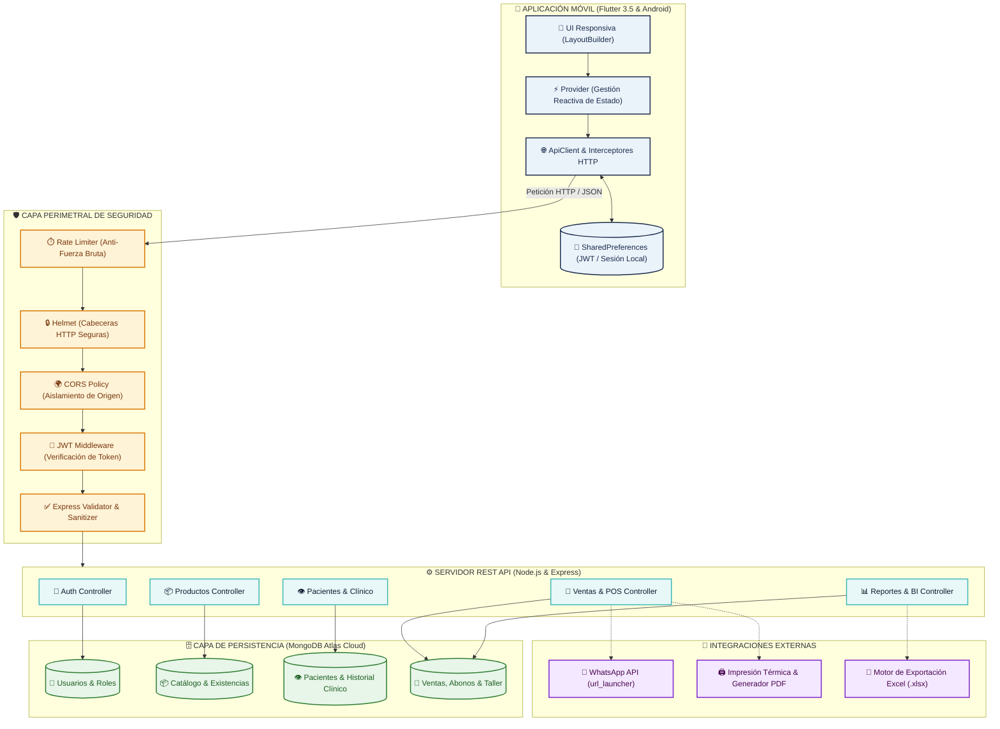

# 👓 Óptica Güzellik – Sistema Integral de Gestión Optométrica y Mostrador

[](https://flutter.dev/)
[](https://nodejs.org/)
[](https://www.mongodb.com/)
[](https://jwt.io/)
[](#-arquitectura-del-sistema)

Plataforma móvil y backend diseñada para digitalizar de punta a punta las operaciones de mostrador, gabinete optométrico, inventario clínico, taller de laboratorio y punto de venta (POS) en **Óptica Güzellik**.

---

## 👥 Equipo de Desarrollo y Roles

| Integrante | Rol | Responsabilidades Clave |
| :--- | :--- | :--- |
| **Paola López (Pao)** | *Scrum Master & Backend Lead* | Arquitectura API REST, seguridad Express, modelos Mongoose, base de datos MongoDB Atlas y capa HTTP en cliente |
| **Gerardo Manzano (Gera)** | *Product Owner & Frontend Architect* | Arquitectura Flutter, autenticación JWT, gestión de estado, diseño UI y módulo optométrico |
| **Jennifer Medina (Jenni)** | *Frontend Developer* | Módulo de catálogo responsivo (GridView), cards personalizadas, sistema de filtrado reactivo y flujo de mostrador |

---

## 🎨 Identidad Visual y Paleta Corporativa

El sistema implementa un tema centralizado en `AppColors` con base en una escala cromática médica y elegante:

* 🟦 **Azul Real (`#1A2B4C`):** Color institucional primario, barras de navegación y encabezados principales.
* 🌑 **Azul Marino (`#0F1A30`):** Sombras de elevación, contraste y estados profundos.
* 🔷 **Azul Cobalto (`#2A4F6E`):** Botones secundarios, iconos de acción y transiciones.
* ❇️ **Turquesa / Aqua (`#40B7B7`):** Color de acento, precios, botones primarios (CTA) e indicadores de éxito.

---

## 🏗️ Arquitectura del Sistema

El ecosistema utiliza una arquitectura desacoplada **Cliente-Servidor** comunicada mediante llamadas asíncronas HTTPS/JSON protegidas:



---

## 🗄️ Modelo de Datos Entidad-Relación

La base de datos relacional sobre MongoDB modela el ciclo clínico, comercial y de existencias:

```mermaid
erDiagram
    USUARIO {
        ObjectId _id PK
        string nombre
        string email
        string password_hash
        string rol "admin | empleado"
        boolean activo
    }

    PACIENTE {
        ObjectId _id PK
        string nombre
        string telefono
        string ocupacion
        object antecedentes "Alergias, Diabetes, Hipertensión"
        object sintomas "Fotofobia, Cefalea, Astenopía"
        object agudeza_visual "AV Lejana, Cerca, Estenopeica"
        object graduacion_actual "OD / OI: Esfera, Cil, Eje, Adición"
    }

    PRODUCTO {
        ObjectId _id PK
        string codigo UK
        string nombre
        string tipo "armazon | mica | lente_contacto | accesorio"
        string marca
        number costo
        number precio_venta
        number stock
        number stock_minimo
        object armazon_specs "Material, Forma, Medidas"
        object mica_specs "Material, Tratamientos, Serie"
    }

    VENTA {
        ObjectId _id PK
        string folio UK
        date fecha
        ObjectId paciente_id FK
        ObjectId vendedor_id FK
        number total
        number anticipo
        number saldo_pendiente
        string metodo_pago "efectivo | tarjeta | transferencia | mixto"
        string estado_pago "pagado | anticipo | pendiente"
        string estado_laboratorio "en_taller | biselado | listo | entregado"
    }

    ITEM_VENTA {
        ObjectId _id PK
        ObjectId producto_id FK
        string nombre
        number cantidad
        number precio_unitario
        number subtotal
        object graduacion "Prescripción montada"
    }

    ABONO {
        ObjectId _id PK
        number monto
        date fecha
        string forma_pago
        string registrado_por
        string nota
    }

    PACIENTE ||--o{ VENTA : "solicita"
    USUARIO ||--o{ VENTA : "registra y atiende"
    VENTA ||--|{ ITEM_VENTA : "contiene productos"
    PRODUCTO ||--o{ ITEM_VENTA : "corresponde a"
    VENTA ||--o{ ABONO : "recibe pagos parciales"
