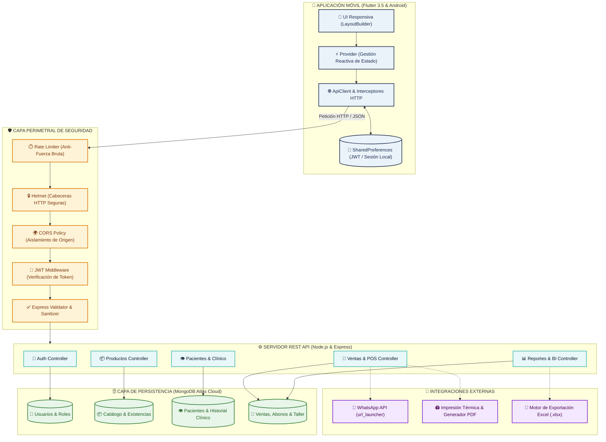
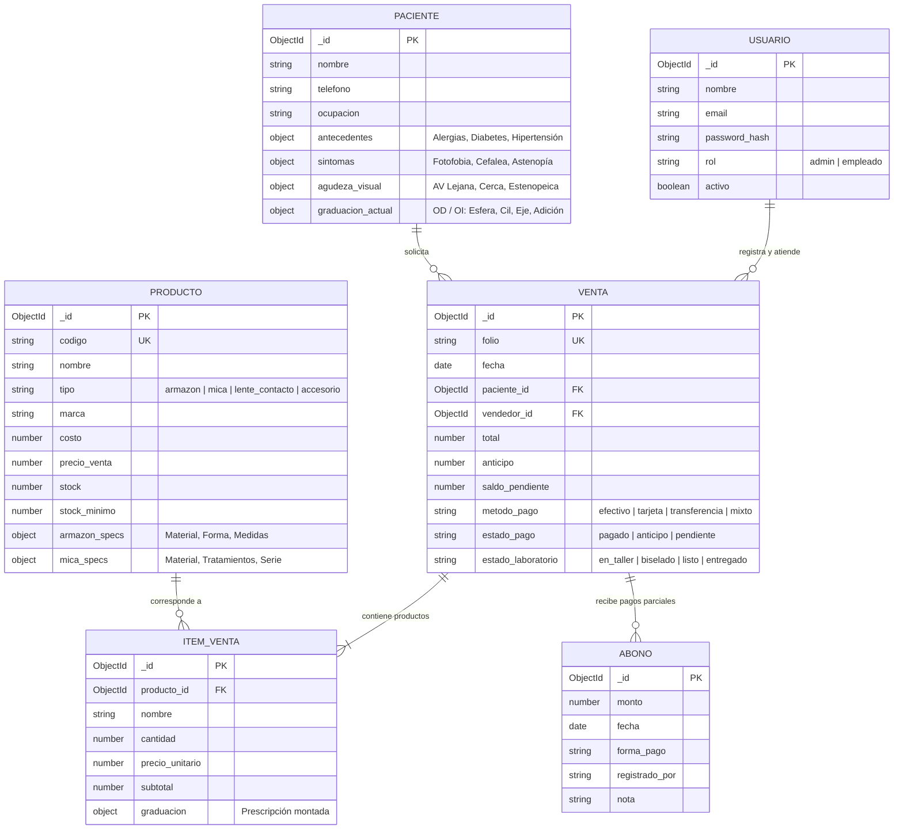

# 👓 Óptica Güzellik – Sistema Integral de Gestión Optométrica y Mostrador

[](https://flutter.dev/)
[](https://nodejs.org/)
[](https://www.mongodb.com/)
[](https://jwt.io/)
[](#-arquitectura-del-sistema)

Plataforma móvil y backend diseñada para digitalizar de punta a punta las operaciones de mostrador, gabinete optométrico, inventario clínico, taller de laboratorio y punto de venta (POS) en **Óptica Güzellik**.

---

## 👥 Equipo de Desarrollo y Roles

| Integrante | Rol | Responsabilidades Clave |
| :--- | :--- | :--- |
| **Paola López (Pao)** | *Scrum Master & Backend Lead* | Arquitectura API REST, seguridad Express, modelos Mongoose, base de datos MongoDB Atlas y capa HTTP en cliente |
| **Gerardo Manzano (Gera)** | *Product Owner & Frontend Architect* | Arquitectura Flutter, autenticación JWT, gestión de estado, diseño UI y módulo optométrico |
| **Jennifer Medina (Jenni)** | *Frontend Developer* | Módulo de catálogo responsivo (GridView), cards personalizadas, sistema de filtrado reactivo y flujo de mostrador |

---

## 🎨 Identidad Visual y Paleta Corporativa

El sistema implementa un tema centralizado en `AppColors` con base en una escala cromática médica y elegante:

* 🟦 **Azul Real (`#1A2B4C`):** Color institucional primario, barras de navegación y encabezados principales.
* 🌑 **Azul Marino (`#0F1A30`):** Sombras de elevación, contraste y estados profundos.
* 🔷 **Azul Cobalto (`#2A4F6E`):** Botones secundarios, iconos de acción y transiciones.
* ❇️ **Turquesa / Aqua (`#40B7B7`):** Color de acento, precios, botones primarios (CTA) e indicadores de éxito.

---

## 🏗️ Arquitectura del Sistema

El ecosistema utiliza una arquitectura desacoplada **Cliente-Servidor** comunicada mediante llamadas asíncronas HTTPS/JSON protegidas:



---

## 🗄️ Modelo de Datos Entidad-Relación

La base de datos relacional sobre MongoDB modela el ciclo clínico, comercial y de existencias:



---

## 🔬 Flujo de Taller y Laboratorio Óptico

Las órdenes que requieren graduación atraviesan una máquina de estados controlada:

```mermaid
stateDiagram-v2
    direction LR
    [*] --> EnTaller: Venta registrada con graduación
    EnTaller --> EnBiselado: Envío de armazón y micas al taller
    EnBiselado --> ControlCalidad: Montaje y biselado completado
    
    state ControlCalidad <<choice>>
    ControlCalidad --> EnBiselado: Rechazado (Desalineación o Rayadura)
    ControlCalidad --> ListoEntrega: Aprobado (Verificado con Frontofocómetro)

    ListoEntrega --> NotificadoWhatsApp: Disparo de notificación automática
    NotificadoWhatsApp --> Entregado: Liquidación de saldo y entrega final
    Entregado --> [*]
```



---

## 📱 Módulos de la Aplicación Móvil

### 1. 🔐 Seguridad, Sesión y Control de Acceso (RBAC)
* Autenticación basada en tokens **JWT (JSON Web Tokens)** con expiración.
* Almacenamiento local seguro en `SharedPreferences` vía `AuthStorage`.
* Enrutamiento dinámico post-login según el rol del usuario:
  * **Dashboard Administrador:** Métricas operativas, control total de usuarios, reportes avanzados y auditoría.
  * **Dashboard Empleado:** Operación de mostrador, expediente clínico, registro de productos y caja.
* Interceptor de red que inyecta automáticamente el encabezado `Authorization: Bearer <token>` y detecta respuestas `401 Unauthorized` para forzar cierre de sesión seguro.

### 2. 📦 Inventario Especializado y Catálogo Interactivo
* **Diseño Responsivo con `LayoutBuilder`:** Adaptabilidad automática de columnas (2 columnas en móviles, 3 en tablets y 4 en pantallas de alta densidad).
* **Esquema de Producto con Especificaciones Ópticas:**
  * **Armazones:** Material, color, forma, medidas (alto, ancho, puente, varilla) y género.
  * **Micas:** Presentación (visión sencilla, progresiva, bifocal), material (CR-39, policarbonato, Hi-Index), tratamientos (antirreflejante, Blue Block, fotocromático, polarizado), series y rango de graduación.
  * **Lentes de Contacto:** Tipo (esférico, tórico, multifocal), material (hidrogel, silicona), curva base, diámetro y tiempo de reemplazo.
* **Control de Existencias:** Distinción cromática para estados de stock:
  * 🟢 **Disponible:** Existencia por encima del umbral mínimo.
  * 🟠 **Stock Bajo:** Inventario igual o inferior a `stock_minimo`.
  * 🔴 **Agotado:** Inventario en 0, con bloqueo de venta en mostrador.
* **Búsqueda Reactiva y Chips de Categoría:** Filtrado instantáneo en memoria y consulta parametrizada por API.

### 3. 👁️ Gabinete Optométrico e Historia Clínica
* **Directorio de Pacientes:** Expediente único indexado con datos demográficos y antecedentes.
* **Examen Clínico Integral:**
  * Sintomatología estructurada (fotofobia, astenopía, cefalea, lagrimeo, ojo seco).
  * Antecedentes patológicos (diabetes, hipertensión, glaucoma, alergias).
  * **Agudeza Visual (AV):** Evaluación monocular (OD / OI) y binocular (AO) de lejos, de cerca, sin corrección, con corrección anterior y estenopeico.
  * **Refracción y Graduación Final:** Esfera, Cilindro, Eje, Adición, Distancia Pupilar (DP) y Altura de centro óptico.
* **Módulo Pediátrico y Revisiones Subsecuentes:** Formularios adaptados para anamnesis infantil y comparativa histórica entre consultas.

### 4. 🛒 Punto de Venta (POS) y Carrito de Mostrador
* Selección directa desde catálogo o vinculación con la receta del paciente.
* Cálculo automático de subtotales, descuentos promocionales e importes totales en precisión decimal.
* **Múltiples Métodos de Pago:** Soporte para transacciones en *Efectivo*, *Tarjeta de Débito/Crédito*, *Transferencia Interbancaria* o *Pago Mixto*.
* **Control de Anticipos y Saldos:**
  * Creación de pedidos con enganche o anticipo inicial.
  * Registro de abonos subsecuentes con cálculo dinámico de `saldo_pendiente`.
  * Estado financiero de venta: `pagado`, `anticipo`, `pendiente`.

### 5. 🔬 Taller y Flujo de Laboratorio Óptico
* Máquina de estados para seguimiento del biselado y montaje de lentes graduados.
* Bitácora histórica con marcas de tiempo (`timestamp`), notas técnicas del optómetra y usuario responsable del cambio de estado.

### 6. 📲 Integraciones y Salida de Documentos
* **Notificación de Entrega vía WhatsApp:** Enlace dinámico mediante `url_launcher` con mensaje parametrizado para avisar al paciente cuando su trabajo esté listo en sucursal.
* **Generación de Tickets y Recetas en PDF:** Creación local mediante `pdf` y `printing` para entrega impresa o digital del comprobante.
* **Exportación a Hojas de Cálculo:** Salida nativa de reportes a `.xlsx` mediante la librería `excel`.
* **Business Intelligence en Mostrador:** Gráficas estadísticas con `fl_chart` (ventas diarias, comparativas mensuales y productos top).

---

## 🌐 Especificación de la API REST

**Base URL:** `http://<HOST>:<PORT>/api`  
*(En emulador Android estándar: `http://10.0.2.2:5000/api`)*

### Encabezados Requeridos
```http
Content-Type: application/json
Authorization: Bearer <JWT_TOKEN>
```

---

### 1. Módulo de Autenticación (`/api/auth`)

| Método | Endpoint | Acceso | Descripción |
| :--- | :--- | :--- | :--- |
| `POST` | `/api/auth/login` | Público | Autentica credenciales y retorna JWT firmado con el perfil de usuario |
| `POST` | `/api/auth/register` | Restringido | Registra nuevos usuarios en el sistema (controlado por variable de entorno) |
| `GET` | `/api/auth/verify` | Público | Valida la vigencia y firma de un token JWT |
| `PUT` | `/api/auth/cambiar-password` | Autenticado | Actualiza la contraseña del usuario en sesión |

#### Ejemplo Request (`POST /api/auth/login`):
```json
{
  "email": "vendedor@guzellik.com",
  "password": "Password123*"
}
```

#### Ejemplo Response (200 OK):
```json
{
  "token": "eyJhbGciOiJIUzI1NiIsInR5cCI6IkpXVCJ9...",
  "user": {
    "id": "672401f8d4e5f2001a4e21a0",
    "nombre": "Paola López",
    "email": "vendedor@guzellik.com",
    "rol": "empleado"
  }
}
```

---

### 2. Módulo de Productos e Inventario (`/api/productos`)

| Método | Endpoint | Acceso | Descripción |
| :--- | :--- | :--- | :--- |
| `GET` | `/api/productos` | Autenticado | Obtiene el catálogo completo (soporta filtros por query `?tipo=armazon`) |
| `GET` | `/api/productos/bajo-stock`| Autenticado | Lista artículos cuyo stock actual está en o por debajo del stock mínimo |
| `GET` | `/api/productos/:id` | Autenticado | Obtiene la ficha técnica detallada de un producto por su `ObjectId` |
| `POST` | `/api/productos` | Admin / Empleado | Da de alta un nuevo producto con atributos ópticos específicos |
| `PUT` | `/api/productos/:id` | Admin / Empleado | Actualiza atributos comerciales o técnicos de un producto |
| `PATCH`| `/api/productos/:id/stock`| Admin / Empleado | Incrementa o decrementa unidades en inventario |
| `PATCH`| `/api/productos/:id/toggle`| Admin / Empleado | Activa o desactiva la visibilidad del producto en catálogo |
| `DELETE`|`/api/productos/:id` | Admin / Empleado | Eliminación física o baja lógica del artículo |

---

### 3. Módulo de Pacientes e Historia Clínica (`/api/pacientes`)

| Método | Endpoint | Acceso | Descripción |
| :--- | :--- | :--- | :--- |
| `GET` | `/api/pacientes` | Autenticado | Retorna el directorio de pacientes con paginación |
| `GET` | `/api/pacientes/buscar` | Autenticado | Búsqueda por coincidencia de nombre, teléfono o expediente |
| `GET` | `/api/pacientes/:id` | Autenticado | Consulta el historial clínico completo y refracciones previas |
| `POST` | `/api/pacientes` | Autenticado | Registra un nuevo paciente en la clínica |
| `PUT` | `/api/pacientes/:id` | Autenticado | Modifica los datos personales o médicos del paciente |
| `POST` | `/api/pacientes/:id/consultas`| Autenticado | Anexa una nueva refracción/consulta al expediente |
| `DELETE`|`/api/pacientes/:id` | Admin | Elimina el expediente del paciente |

---

### 4. Módulo de Ventas, Caja y Taller (`/api/ventas`)

| Método | Endpoint | Acceso | Descripción |
| :--- | :--- | :--- | :--- |
| `GET` | `/api/ventas` | Autenticado | Consulta las ventas realizadas con filtros de estado |
| `GET` | `/api/ventas/fechas` | Autenticado | Reporte de transacciones filtradas por rango de fechas |
| `GET` | `/api/ventas/paciente/:pacienteId` | Autenticado | Historial de compras y encargos de un paciente específico |
| `GET` | `/api/ventas/:id` | Autenticado | Detalle completo de una venta, desglose de ítems y abonos |
| `POST` | `/api/ventas` | Autenticado | Registra una orden de venta o encargo con anticipo |
| `PATCH`| `/api/ventas/:id/estado` | Autenticado | Actualiza el estado de laboratorio del trabajo óptico |
| `PATCH`| `/api/ventas/:id/pago` | Autenticado | Actualiza el estado financiero de la orden |
| `POST` | `/api/ventas/:id/abono` | Autenticado | Registra un abono al saldo pendiente con comprobante |
| `GET` | `/api/ventas/:id/abonos`| Autenticado | Historial cronológico de abonos recibidos para la orden |
| `DELETE`|`/api/ventas/:id` | Solo Admin | Cancela una transacción y restituye el stock al inventario |

---

### 5. Módulo de Reportería y Dashboard (`/api/reportes` y `/api/dashboard`)

| Método | Endpoint | Acceso | Descripción |
| :--- | :--- | :--- | :--- |
| `GET` | `/api/dashboard/stats` | Autenticado | KPIs en tiempo real: ingresos del día/mes, clientes y productos críticos |
| `GET` | `/api/reportes/resumen` | Autenticado | Consolidado general de ingresos y volumen de transacciones |
| `GET` | `/api/reportes/ventas/dia`| Autenticado | Detalle de operaciones del corte de caja diario |
| `GET` | `/api/reportes/productos/top` | Autenticado | Ranking de armazones, micas y lentes de contacto de mayor rotación |
| `GET` | `/api/reportes/ventas/por-empleado`| Autenticado | Productividad y rendimiento comisionable por vendedor |

---

## 🛠️ Stack de Tecnologías y Librerías

### Backend (API REST)
* **Runtime:** Node.js (v18+)
* **Framework:** Express.js v4.21
* **Base de Datos:** MongoDB Atlas mediante Mongoose ORM v8.9
* **Seguridad y Criptografía:**
  * `jsonwebtoken` (Generación y verificación de tokens de sesión)
  * `bcryptjs` (Hashing unidireccional de contraseñas con salt)
  * `helmet` (Protección de cabeceras HTTP y política de aislamiento)
  * `express-rate-limit` (Prevención de ataques de fuerza bruta y DoS)
  * `cors` (Control de orígenes cruzados para emulador y red local)
* **Validación de Datos:** `express-validator` con sanitización de inputs y validación de `ObjectId` de MongoDB.

### Frontend (Mobile App)
* **SDK:** Flutter 3.5+ / Dart 3.5+
* **Consumo HTTP:** `http` v1.2 con capa de interceptores centralizada.
* **Persistencia Local:** `shared_preferences` (Tokens de sesión y preferencias de mostrador).
* **Gestión de Estado:** `provider` para estado reactivo en carrito y navegación.
* **Visualización de Datos:** `fl_chart` para gráficas analíticas de desempeño.
* **Documentación & Archivos:** `pdf`, `printing`, `excel`, `path_provider`.
* **Hardware & Sistema:** `url_launcher` (integración nativa con WhatsApp) y `share_plus`.

---

## ⚙️ Guía de Instalación y Despliegue Local

### 1. Prerrequisitos
* **Node.js** `>= 18.0.0` y **npm** `>= 9.0.0`
* **Flutter SDK** `>= 3.5.0` y **Android Studio** (con emulador configurado)
* Cuenta activa o clúster en **MongoDB Atlas**

---

### 2. Configuración del Backend

1. Entra a la carpeta del servidor:
   ```bash
   cd backend
   ```
2. Instala las dependencias:
   ```bash
   npm install
   ```
3. Crea un archivo `.env` en la raíz de `backend/` con las siguientes variables:
   ```env
   PORT=5000
   MONGODB_URI=mongodb+srv://<usuario>:<password>@<cluster>.mongodb.net/optica_guzellik?retryWrites=true&w=majority
   JWT_SECRET=tu_clave_secreta_jwt_muy_segura_2026
   JWT_EXPIRES_IN=24h
   CORS_ORIGIN=*
   ALLOW_REGISTER=true
   ```
4. Inicia el servidor en modo desarrollo:
   ```bash
   npm run dev
   ```
   *(El servidor correrá en `http://localhost:5000`)*.

---

### 3. Configuración del Frontend (Flutter)

1. Entra a la carpeta de la aplicación móvil:
   ```bash
   cd ../frontend
   ```
2. Instala los paquetes de Dart:
   ```bash
   flutter pub get
   ```
3. Verifica la URL base de conexión en `lib/utils/app_config.dart`:
   ```dart
   // Para Emulador Oficial de Android Studio:
   static const String apiBaseUrl = 'http://10.0.2.2:5000/api';

   // Para dispositivo físico en la misma red Wi-Fi:
   // static const String apiBaseUrl = 'http://192.168.1.XX:5000/api';
   ```
4. Ejecuta la aplicación en tu emulador o dispositivo conectado:
   ```bash
   flutter run
   ```

---

## 🔒 Consideraciones de Seguridad y Buenas Prácticas

1. **Aislamiento DNS de Atlas en Windows:** El servidor incluye resolución explícita hacia `8.8.8.8` y `8.8.4.4` para neutralizar fallos `querySrv ECONNREFUSED` ocasionados por el resolver nativo de Node.js en plataformas Windows.
2. **Sanitización de Consultas NoSQL:** Los controladores validan y casclean estrictamente los parámetros de entrada y formatos `ObjectId` antes de ejecutar queries en Mongoose, mitigando riesgos de inyección NoSQL.
3. **Límites de Carga:** El parser de Express restringe el tamaño del payload a un máximo de `256kb` para proteger la memoria del proceso frente a saturación deliberada.
4. **Resguardo de Secretos:** Ningún archivo de configuración `.env` ni credencial de acceso a base de datos se almacena en el control de versiones, manteniéndose aislados bajo reglas de `.gitignore`.
