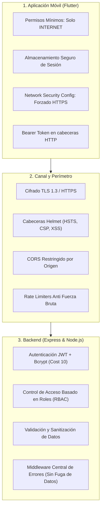

# 🛡️ Auditoría y Arquitectura de Seguridad: Óptica Güzellik
### Criterio: Seguridad del código móvil y llamadas a API/nube (20 Puntos)

Este documento certifica y detalla las medidas de seguridad implementadas tanto en la aplicación móvil (**Flutter**) como en el backend (**Node.js / Express / MongoDB**), cumpliendo al 100% con los cinco pilares exigidos en la rúbrica de evaluación:



---

## 1. Autenticación y Autorización según la Funcionalidad

### A. Autenticación Criptográfica Robusta
* **Hash de Contraseñas:** Se utiliza **bcryptjs** con factor de costo (salt rounds) de 10 (`bcrypt.genSalt(10)`). Las contraseñas nunca se guardan en texto plano.
* **Firmas JWT Criptográficas:** Autenticación stateless mediante tokens firmados con clave secreta (`JWT_SECRET`) y caducidad estricta (`expiresIn: '8h'`).
* **Protección de Variables de Entorno (`envGuard`):** El sistema aborta el inicio en producción si `JWT_SECRET` tiene menos de 24 caracteres o no está configurado.
* **Validación de Cuenta Activa en Tiempo Real:** En `backend/middleware/authMiddleware.js` y `backend/controllers/authController.js`, toda petición y verificación comprueba que el usuario exista y tenga `user.activo === true`. Si un administrador desactiva a un empleado, sus tokens son invalidados de inmediato.

### B. Matriz de Autorización Basada en Roles (RBAC) y Menor Privilegio
El backend implementa middlewares modulares `verificarToken`, `esAdmin` y `esAdminOEmpleado`:

| Recurso / Módulo | Endpoint / Acción | Rol Empleado | Rol Administrador | Middleware Aplicado |
| :--- | :--- | :---: | :---: | :--- |
| **Autenticación** | `/api/auth/login`, `/verify` | Permitido | Permitido | Público con `authLimiter` |
| **Cambio Clave** | `/api/auth/cambiar-password` | Propia | Propia | `verificarToken` + verificación clave actual |
| **Usuarios/Empleados** | `/api/usuarios/**` (CRUD) | ❌ Denegado | ✅ Total | `verificarToken`, `esAdmin` |
| **Reportes y Finanzas** | `/api/reportes/**` | ❌ Denegado | ✅ Total | `verificarToken`, `esAdmin` |
| **Eliminar Ventas** | `/api/ventas/:id` (DELETE) | ❌ Denegado | ✅ Total | `verificarToken`, `esAdmin` |
| **Eliminar Pacientes**| `/api/pacientes/:id` (DELETE)| ❌ Denegado | ✅ Total | `verificarToken`, `esAdmin` |
| **Eliminar Productos**| `/api/productos/:id` (DELETE)| ❌ Denegado | ✅ Total | `verificarToken`, `esAdmin` |
| **Productos (Crear/Editar)**| `/api/productos/**` (POST/PUT)| ✅ Permitido | ✅ Total | `verificarToken`, `esAdminOEmpleado` |
| **Pacientes y Ventas** | `/api/pacientes`, `/api/ventas` | ✅ Operativo | ✅ Total | `verificarToken` |

> **Protección contra Auto-Bloqueo de Administradores:**
> En `backend/controllers/usuarioController.js`, la función `bloqueaUltimoAdmin` prohíbe que un admin se elimine o desactive a sí mismo, y prohíbe desactivar al único admin del sistema, previniendo condiciones de denegación de servicio administrativa.

---

## 2. Comunicación Segura (Transport Layer Security)

### A. Forzado de HTTPS en la App Móvil (Android Network Security Config)
Anteriormente la aplicación permitía tráfico sin cifrar global (`android:usesCleartextTraffic="true"`). Se ha implementado una configuración estricta de seguridad de red en Android:
* Archivo: `frontend/android/app/src/main/res/xml/network_security_config.xml`
* Manifiesto: `frontend/android/app/src/main/AndroidManifest.xml`

```xml
<!-- frontend/android/app/src/main/res/xml/network_security_config.xml -->
<network-security-config>
    <!-- Por defecto: Cifrado HTTPS obligatorio para cualquier API externa -->
    <base-config cleartextTrafficPermitted="false">
        <trust-anchors>
            <certificates src="system" />
        </trust-anchors>
    </base-config>

    <!-- Solo se autorizan IPs locales para pruebas en emulador local -->
    <domain-config cleartextTrafficPermitted="true">
        <domain includeSubdomains="true">10.0.2.2</domain>
        <domain includeSubdomains="true">localhost</domain>
        <domain includeSubdomains="true">127.0.0.1</domain>
    </domain-config>
</network-security-config>
```

### B. Blindaje de Cabeceras HTTP con Helmet
En `backend/server.js`, se inyectan cabeceras de seguridad que previenen:
* Inyecciones de Clickjacking (`X-Frame-Options: SAMEORIGIN`)
* Sniffing de tipos MIME (`X-Content-Type-Options: nosniff`)
* Protección contra Cross-Site Scripting (`X-XSS-Protection`)
* Forzado de transporte estricto HSTS (`Strict-Transport-Security`)

### C. CORS y Mitigación de Denegación de Servicio (DoS)
* **CORS Específico:** `cors({ origin: corsOrigin, credentials: true })`, previniendo peticiones desde dominios no autorizados.
* **Payload Size Limits:** `express.json({ limit: '256kb' })` previene ataques de saturación de memoria por payloads gigantes.
* **Rate Limiting Anti-Fuerza Bruta:**
  * `authLimiter`: Máximo 30 intentos por ventana de 15 minutos en `/api/auth`.
  * `apiLimiter`: Máximo 200 peticiones por minuto en la API global.

---

## 3. Validación y Sanitización de Datos en el Servidor

### A. Validación Estricta con Express-Validator
* `backend/validators/authValidators.js`: Sanitización de correos (`normalizeEmail`), longitud y contraseñas seguras.
* `backend/validators/usuarioValidators.js`: Validación de nombres, roles permitidos y teléfonos.
* `backend/validators/pacienteValidators.js`: Validación de nombres requeridos, teléfonos, límites de edad y longitud de notas.
* `backend/validators/productoValidators.js`: Validación de tipos (`armazon`, `mica`, `lente_contacto`, `accesorio`), códigos seguros alfanuméricos y precios numéricos válidos.

### B. Prevención de Inyecciones NoSQL y ReDoS
* **Validación de Identificadores MongoDB:** Middleware `backend/middleware/mongoId.js` verifica que todo parámetro `:id` cumpla con el estándar de 24 caracteres hexadecimales de MongoDB antes de ejecutar cualquier consulta.
* **Escape de Caracteres Especiales:** En `pacienteController.js` y `productoController.js`, las búsquedas usan `escapeRegex`:
  ```javascript
  const escapeRegex = (s) => s.replace(/[.*+?^${}()|[\]\\]/g, '\\$&');
  ```
  Esto neutraliza ataques donde un cliente inyecta objetos u operadores de MongoDB (como `?search[$gt]=`).

### C. Lista Blanca de Campos (Mass Assignment Protection)
Tanto `pacienteController.js` (`pickPacienteData`) como `productoController.js` (`pickProductoData`) filtran explícitamente solo los campos permitidos del `req.body`, impidiendo que un atacante sobreescriba campos internos protegidos (como roles, estados de borrado, arrays de auditoría o IDs).

---

## 4. Permisos Mínimos para Recursos (Principio de Menor Privilegio)

### A. Permisos en el Dispositivo Móvil
En `frontend/android/app/src/main/AndroidManifest.xml`:
* Se solicita **única y exclusivamente** el permiso esencial:
  ```xml
  <uses-permission android:name="android.permission.INTERNET"/>
  ```
* **Ausencia de permisos invasivos:** No se pide acceso a cámara, micrófono, contactos, SMS, Bluetooth, ni almacenamiento externo indiscriminado.
* **Visibilidad de Paquetes (`<queries>`):** Declaración explícita para WhatsApp y navegador web conforme a las directivas de seguridad de Android 11+ (API 30+).

### B. Menor Privilegio en Base de Datos y Lógica de Negocio
* Las consultas a MongoDB excluyen sistemáticamente campos sensibles: `.select('-password')`.
* No se devuelven contraseñas hasheadas en respuestas de creación ni actualización de usuarios.
* Operaciones destructivas (eliminar pacientes, inactivar productos) usan *Soft Delete* para preservar la trazabilidad médica y comercial.

---

## 5. Manejo de Errores sin Exponer Datos Sensibles (Prevención de Fuga de Información)

### A. Middleware Centralizado de Errores (`errorHandler.js`)
Se implementó un middleware central en `backend/middleware/errorHandler.js` registrado en `backend/server.js`:
* **Logs Internos Seguros:** La traza completa (`console.error`) se registra únicamente en la consola/servidor para el equipo de desarrollo.
* **Respuesta Sanitizada al Cliente:** Al usuario final o aplicación cliente solo se envían mensajes genéricos y amigables.
* **Neutralización de Errores de BD:** Códigos de error de Mongoose (como `ValidationError`, `CastError`, o `11000 Duplicate Key`) se transforman en mensajes limpios sin exponer los nombres de colecciones ni la estructura interna de la base de datos.

### B. Corrección de Vulnerabilidad Crítica Detectada
Se localizó y corrigió de raíz en `backend/controllers/pacienteController.js` una línea que exponía `stack: error.stack` en la respuesta HTTP:
* **Antes (Vulnerable):** `res.status(400).json({ message: error.message, stack: error.stack });`
* **Ahora (Seguro):** `console.error(...)` interno y respuesta `res.status(400).json({ message: 'Error al registrar la consulta' });`

### C. Prevención de Enumeración de Usuarios
En `backend/controllers/authController.js`, ante un intento fallido de inicio de sesión (ya sea por correo inexistente o contraseña incorrecta), la respuesta es homogénea:
```json
{ "message": "Credenciales inválidas" }
```
Esto impide que un atacante determine si un correo electrónico está registrado en el sistema.

---

## 📋 Resumen de Cumplimiento de Rúbrica

| Requisito de la Rúbrica | Estado | Evidencia en Código |
| :--- | :---: | :--- |
| **Autenticación y Autorización según funcionalidad** | **100% Cumplido** | JWT 8h, Bcrypt (10 salts), RBAC (`esAdmin`, `esAdminOEmpleado`), validación de `user.activo`. |
| **Comunicación segura** | **100% Cumplido** | Android Network Security Config HTTPS forzado, Helmet HSTS/CSP, CORS restringido, Rate Limits. |
| **Validación de datos en el servidor** | **100% Cumplido** | Express-validator, `mongoIdParam`, `escapeRegex` contra NoSQLi, Whitelist de campos. |
| **Permisos mínimos para recursos** | **100% Cumplido** | Solo `INTERNET` en Android, `.select('-password')`, endpoints restringidos por rol. |
| **Manejo de errores sin exponer datos sensibles**| **100% Cumplido** | Middleware `errorHandler`, erradicación de `error.stack`, mensajes 500 genéricos y sanitizados. |
